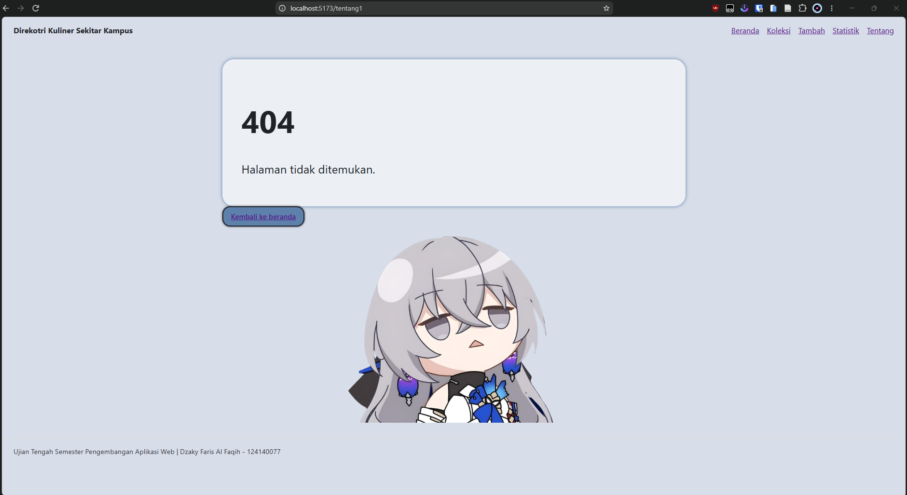

# Nama Aplikasi

Nama: Dzaky Faris Al Faqih
NIM: 124140077
Kelas: RB
Tema: Direktori Kuliner Sekitar Kampus
Deployment: https://dzhark12.github.io/uts-paw/

*Gambar 1. Halaman Beranda*

*Gambar 2. Halaman Koleksi*

*Gambar 3. Halaman Tambah*

*Gambar 4. Halaman Statistik*

*Gambar 5. Halaman Tentang*

*Gambar 6. Halaman 404*

## Fitur

- Menampilkan ringkasan statistik di beranda
- Pencarian berdasarkan judul dan filter kategori
- menampilkan direktori kuliner sekitar kampus dengan `fetch`
- Halaman detail informasi Toko kuliner
- Form penambahan data kuliner
- Ringkasan statistik menggunakan tabel di page statistik berdasarkan kategori
- Memberi komentar pada tempat
- Memberi rating pada tempat

## Menjalankan secara lokal

cd app
npm install
npm run dev

## Konsep React yang dipakai

Komponen fungsional dengan props minimal 5 (`KartuItem`, `Komentar`, - `Layout`, `KotakPencarian`, `Rating`)
- `useState` dan `useEffect`.
- Context API (`koleksiContext`, `KoleksiProvider`, `useContext`, `createContext`.)
- custom hooks (`useKoleksi.js`, dan `useLocalStorage.js`)
- React Router: NavLink atau Link, useParams, dan useNavigate.
- Rendering daftar dengan map dan key, rendering bersyarat, form terkontrol.
- HTML semantik (header, nav, main, footer) dan CSS responsif.
